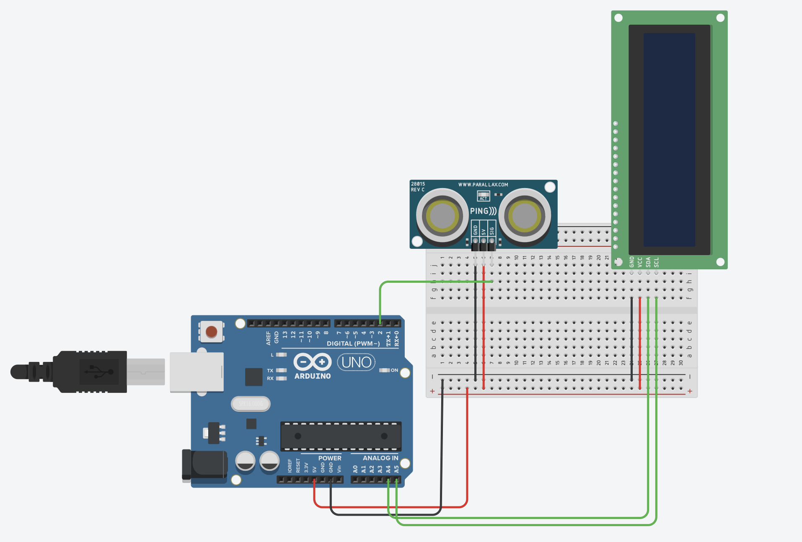

# Compteur automatique de mouvements avec Arduino

## 1. Présentation du projet

Ce projet consiste à développer un système électronique capable de détecter les mouvements réalisés pendant un exercice physique et de compter automatiquement les répétitions.

L'objectif est de concevoir un dispositif pratique utilisant Arduino et un capteur de distance.

## 2. Objectifs

- Détecter les variations de distance.
- Identifier les mouvements effectués.
- Compter automatiquement les répétitions.
- Afficher le nombre de répétitions sur un écran LCD.

## 3. Matériel utilisé

- Carte Arduino
- Capteur ultrasonique
- Écran LCD avec interface I2C
- Fils de connexion

## Schéma électronique

## 4. Fonctionnement

Le capteur mesure la distance entre le dispositif et un objet. Arduino analyse les variations de distance et utilise un programme pour déterminer si un mouvement correspond à une répétition.

Le résultat est ensuite affiché sur l'écran LCD.

## 5. Technologies utilisées

- Arduino
- C++
- Électronique
- Capteur ultrasonique
- Simulation et expérimentation

## 6. État du projet

Projet en cours de développement.

## 7. Améliorations envisagées

- Améliorer la précision de détection.
- Éviter les doubles comptages.
- Optimiser le fonctionnement du système.
- Concevoir un dispositif physique compact.
