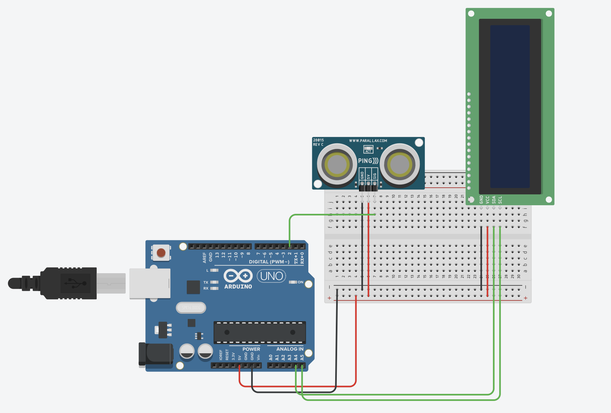

# Compteur automatique de mouvements avec Arduino

## 1. Présentation du projet

Ce projet consiste à développer un système électronique capable de détecter les mouvements réalisés pendant un exercice physique et de compter automatiquement les répétitions.

L'objectif est de concevoir un dispositif pratique utilisant Arduino et un capteur de distance.

## 2. Objectifs

- Détecter les variations de distance.
- Identifier les mouvements effectués.
- Compter automatiquement les répétitions.
- Afficher le nombre de répétitions sur un écran LCD.

## 3. Matériel utilisé

- Carte Arduino
- Capteur ultrasonique
- Écran LCD avec interface I2C
- Fils de connexion

## Schéma électronique

## 4. Fonctionnement

Le capteur mesure la distance entre le dispositif et un objet. Arduino analyse les variations de distance et utilise un programme pour déterminer si un mouvement correspond à une répétition.

Le résultat est ensuite affiché sur l'écran LCD.

## 5. Technologies utilisées

- Arduino
- C++
- Électronique
- Capteur ultrasonique
- Simulation et expérimentation

## 6. État du projet

Projet en cours de développement.
## 7. Difficultés rencontrées

Au cours du développement de ce projet, j'ai travaillé sur plusieurs aspects techniques :

La compréhension du fonctionnement du capteur ultrasonique.

La communication entre Arduino et l'écran LCD via I2C.

La programmation de la détection des mouvements.

La gestion du comptage pour éviter les répétitions détectées plusieurs fois.

Ces difficultés m'ont permis de mieux comprendre l'interaction entre les composants électroniques et le programme informatique.
## 8. Améliorations envisagées

- Améliorer la précision de détection.
- Éviter les doubles comptages.
- Optimiser le fonctionnement du système.
- Concevoir un dispositif physique compact.
## 9. Montages réalisés 

[📸 Voir la photo du montage](./WhatsApp%20Image%202026-11-16%20at%2012.43.25.jpeg)
Il s'agit du montage avec un 7 segment comme afficheur 

[📷 Voir la photo finale du projet](projet_final.jpeg)

## 10. Commentaire 
J'ai commencé par tester le programme avec un digit 7 segment , ce qui m'a permis de comprendre le fonctionnement de l'appareil et sont branchement . Par la même occasion j'ai eu a rencontrer des problèmes par rapport a la nature du 7 segment si il s'agit d'un anode commun le branchement commun se fait sur le 5v par contre si il s'agit d'un cathode commun le branchement ce fait sur le GND . Et par la meme occasion le code change en fonction de la nature de cette appareil . j'ai rencontrer un autre probleme avec le capteur , théoriquement j'ai travaillé avec un capteur ultrasonique 3 broches mais quand j'ai eu les pieces j'ai eu un capteur 4 broches ca change aussi le code . 
